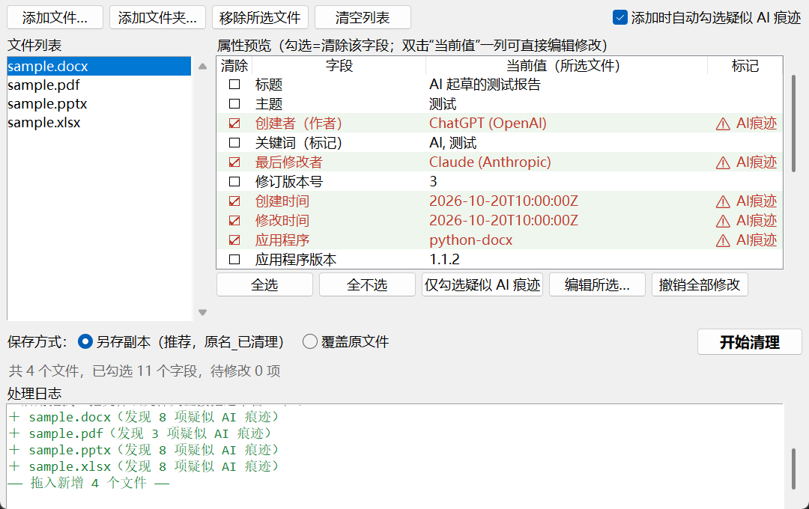

<div align="center">

# 🧹 文档属性清理工具

**一键清除或修改 Word / Excel / PPT / PDF 的属性（元数据），抹掉 AI 生成痕迹**

[](https://github.com/yuujinng/doc-meta-cleaner/actions/workflows/ci.yml)
[](LICENSE)
[](https://www.python.org/)
[](https://github.com/yuujinng/doc-meta-cleaner#快速开始)



*拖入文件 → 疑似 AI 痕迹自动标红并勾选 → 一键清理*

</div>

---

## ✨ 特性

- 🤖 **AI 痕迹自动识别** — `ChatGPT`、`Claude`、`python-docx`、`openpyxl`、`Skia/PDF` 等生成来源关键词自动标红、默认勾选
- 🧽 **彻底清除** — 作者、最后修改者、应用程序、创建/修改时间、编辑统计、公司、自定义属性、PDF 的 Info 字典与 XMP 元数据包……
- ✏️ **随意修改** — 任意属性改成任意值，支持"应用到所有文件"批量统一，日期自动转成文档标准格式
- 🖱️ **拖拽即用** — 文件或整个文件夹（递归扫描）直接拖进窗口
- 🔒 **正文零损伤** — 只改写属性部件，文档内容逐字节保留；覆盖模式先写临时文件再原子替换，失败不伤原文件
- 📦 **零安装门槛** — 双击 `bat` 启动，缺什么组件自动联网补装一次

## 🕵️ 它能识别哪些痕迹？

| 痕迹类型 | 典型表现 |
| --- | --- |
| 作者 / 最后修改者 | `ChatGPT`、`Claude`、`python-docx` 等 |
| 应用程序 | 生成程序显示为脚本库（openpyxl、pandoc、Skia/PDF 等） |
| 时间特征 | 创建时间与修改时间精确到秒完全相同 |
| 编辑统计 | 总编辑时间为 0 分钟 |
| PDF 内嵌信息 | Info 字典中的 Producer/Creator、XMP 元数据包、页面级内嵌元数据 |
| 其他 | 公司、经理、自定义属性、超链接基础里的本机路径等 |

> 「疑似 AI 痕迹」按关键词和规则自动识别，可能有漏报/误报，清理前请过目一遍勾选列表。

## 🚀 快速开始

**方式一：直接运行（推荐）**

1. 安装 [Python 3.11+](https://www.python.org/downloads/)（勾选 *"Add Python to PATH"*）
2. 下载本仓库（*Code → Download ZIP*，或 `git clone`）
3. 双击 **文档属性清理工具.bat**

首次启动会自动联网安装 `pypdf`、`tkinterdnd2`（仅一次），界面出现「PDF 支持：已就绪」即一切正常。启动时会有一个黑色命令行窗口随界面一起存在，关闭界面后自动退出。

**方式二：命令行**

```bash
git clone https://github.com/yuujinng/doc-meta-cleaner.git
cd doc-meta-cleaner
pip install pypdf tkinterdnd2
python doc_meta_cleaner.py
```

## 📖 使用方法

**清除属性，四步：**

1. **把文件或整个文件夹直接拖进窗口**（文件夹会递归找出所有支持的文档），或点**添加文件** / **添加文件夹**；
2. 右侧列出所有属性，**疑似 AI 痕迹的行标红并自动勾选**，点第一列 ☑/☐ 或双击行即可勾选/取消，勾选会应用到列表里的所有文件；
3. 选择保存方式：**另存副本**（原名_已清理，推荐）或**覆盖原文件**；
4. 点**开始清理**，下方日志逐个文件报告清除了哪些字段。

**修改属性：** 在左侧选中文件，**双击属性表"当前值"一列**（或选中行后点**编辑所选…**），在弹窗里输入新值并保存：

- 可勾选"应用到列表中的所有文件"，一次给整批文档统一改作者等；
- 日期字段支持 `2026-10-20 10:00:05` 之类的写法，保存时自动转成文档标准格式；修订次数、总编辑时间需要整数；
- 输入框**留空保存 = 清除该字段**；
- 同一个字段的"修改"与"清除"勾选互斥，后设置的生效；
- 该文件没有的字段（如类别、PDF 主题）保存后会自动新建；自定义属性只能改已有的值，不能新建；
- 点**撤销全部修改**可取消尚未处理的修改项；
- PDF 的 XMP 元数据包不支持逐项编辑，只能整体清除；但修改/清除 Info 字段时会自动同步 XMP，不会残留旧值。

## 📂 支持的格式

| 类型 | 扩展名 | 清除 | 修改 |
| --- | --- | :-: | :-: |
| Word | `.docx` `.docm` | ✅ | ✅ |
| Excel | `.xlsx` `.xlsm` | ✅ | ✅ |
| PPT | `.pptx` `.pptm` `.ppsx` `.ppsm` | ✅ | ✅ |
| PDF | `.pdf` | ✅ | ✅（XMP 仅整体清除） |

旧的 `.doc/.xls/.ppt` 二进制格式暂不支持。

## 🔒 清理原理（安全边界）

- Office 文档本质是 ZIP+XML 包，工具只改写 `docProps/core.xml`、`docProps/app.xml`、`docProps/custom.xml` 三个属性部件，**正文、样式、图片等其余内容逐字节保留**，不影响文档显示；新建字段会按文档规范插入到正确位置，文件缺少属性部件时也会自动新建并登记，保证 Word/Excel/PPT 正常打开。
- PDF 通过 pypdf 克隆后改写 Info 字典字段与 /Metadata(XMP)（含挂在页面对象上的内嵌元数据），页面内容不变；修改/清除 Info 字段时会同步改写 XMP 包，不会残留旧值。
- 「覆盖原文件」模式先写临时文件再原子替换，失败不会破坏原文件。

## ⚠️ 注意事项

- 清理前**关闭**正在 Word/WPS/预览器中打开的文档，否则文件被占用会失败。
- 清理的是文档**属性**，不会检测或修改正文内容本身。
- AI 检测工具还可能通过文风判断，本工具只负责元数据层面的干净。

## ❓ 常见问题

- **双击后窗口一闪而过 / 报错**：启动器必须保持 ASCII + CRLF 格式保存，不要用编辑器修改后另存为 UTF-8。若损坏，可运行 `python tests/_make_bat.py` 重新生成。
- **提示找不到 Python**：安装 Python 3 时勾选 "Add Python to PATH"，或改用命令行 `python doc_meta_cleaner.py` 启动。
- **PDF 文件添加失败**：看界面日志最上方是否提示「PDF 支持：未安装」，手动运行 `pip install pypdf` 后重开工具即可。
- **拖拽文件进窗口没反应**：说明可选组件 tkinterdnd2 未装上，手动运行 `pip install tkinterdnd2` 后重开工具即可（不影响其他功能）。

## 🗂️ 项目结构

```
doc-meta-cleaner/
├── doc_meta_cleaner.py       主程序（核心逻辑 + 界面）
├── 文档属性清理工具.bat        双击启动
├── 示例文件/                  4 个带 AI 痕迹的演示文档，可先拿它们试手
├── docs/
│   └── screenshot.png        README 界面截图
├── tests/
│   ├── run_tests.py          核心逻辑自动化测试
│   ├── gui_smoke.py          GUI 冒烟测试
│   ├── _make_bat.py          重新生成启动器
│   └── _make_screenshot.py   重新生成 README 截图
└── .github/workflows/ci.yml  GitHub Actions CI
```

## 🛠️ 开发与测试

```bash
python tests/run_tests.py         # 核心逻辑测试（自动生成样例并验证清理结果）
python tests/gui_smoke.py         # GUI 冒烟测试
python tests/_make_screenshot.py  # 重新生成 README 截图
python tests/_make_bat.py         # 重新生成启动器（保持 ASCII + CRLF）
```

## 📄 许可证

[MIT](LICENSE) © 2026 yuujinng
